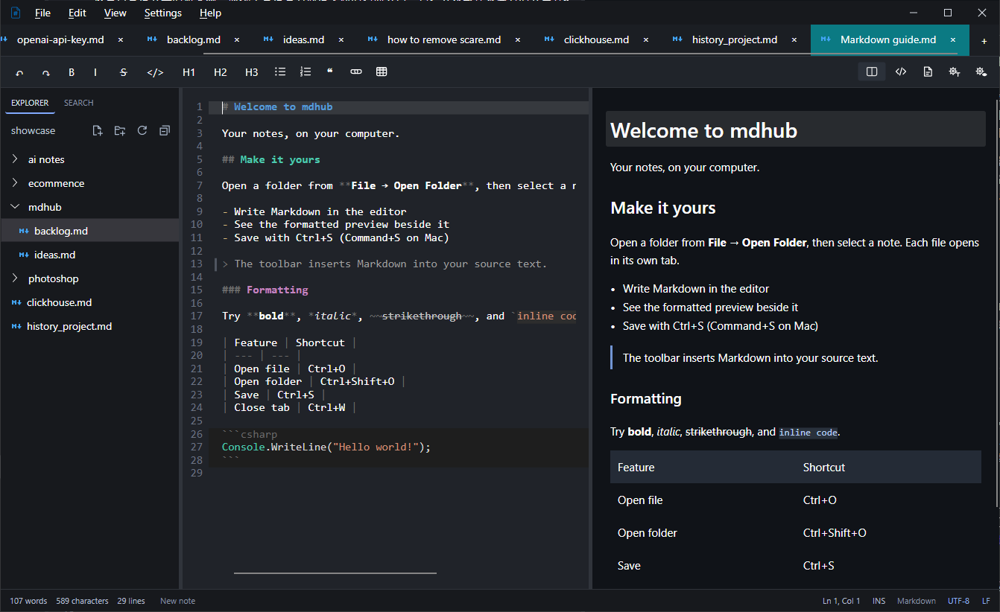
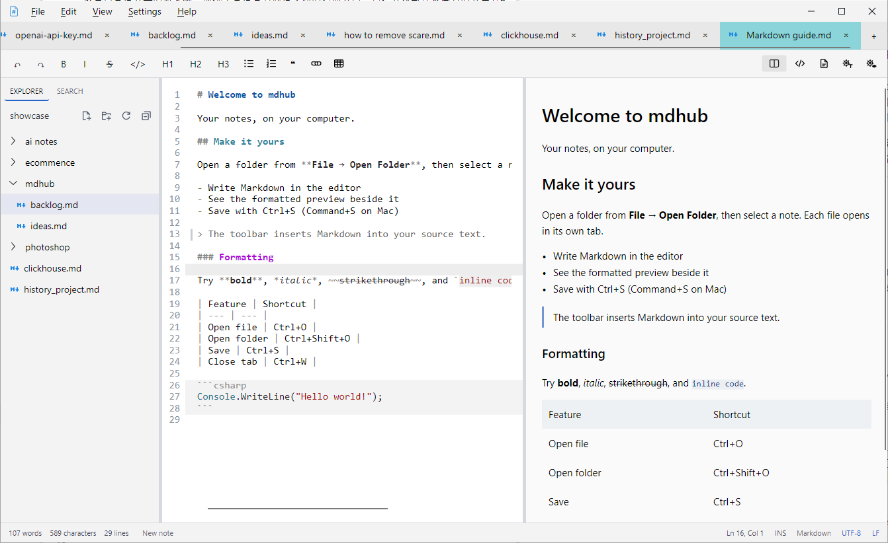

<p align="center">
  
</p>

<h1 align="center">MDHub</h1>

<p align="center">
  Your notes, as plain Markdown files on your own disk: fast to search, simple to write, readable forever.
</p>

MDHub is a desktop app for keeping personal notes and journals locally. It has no proprietary format or database. Every note is an ordinary text file that any editor can open, now or decades from now. On top of that, MDHub adds fast search and just enough formatting.

<p align="center">
  
  
</p>

## Features

- **Plain `.md` files, no lock-in.** Notes and journals are saved and organized as standard Markdown files in ordinary folders. Any text editor can open them, even everyone's favorite, vim.
- **Fully offline.** Everything works locally, with no account, no cloud and no network.
- **Fast search.** Find anything across all your saved notes in moments.
- **Speaks your language and your files.** The interface comes in 8 languages. Legacy encodings such as Big5 open correctly, and LF and CRLF line endings are kept as they are.
- **A familiar editor.** The editor works like VS Code and uses similar keyboard shortcuts.

## Download

MDHub 1.0.0 is available from [GitHub Releases](https://github.com/hong56hk/mdhub/releases).

## Build from source

Install the [.NET 10 SDK](https://dotnet.microsoft.com/download), then run:

```bash
git clone https://github.com/hong56hk/mdhub
cd mdhub
dotnet run --project Mdhub.csproj
```

## License

MDHub is released under the [MIT License](LICENSE).

MDHub includes third-party components, such as the Hunspell spell-checking engine, spelling dictionaries and file-type icons, under their own licenses. See [THIRD-PARTY-NOTICES.md](THIRD-PARTY-NOTICES.md).