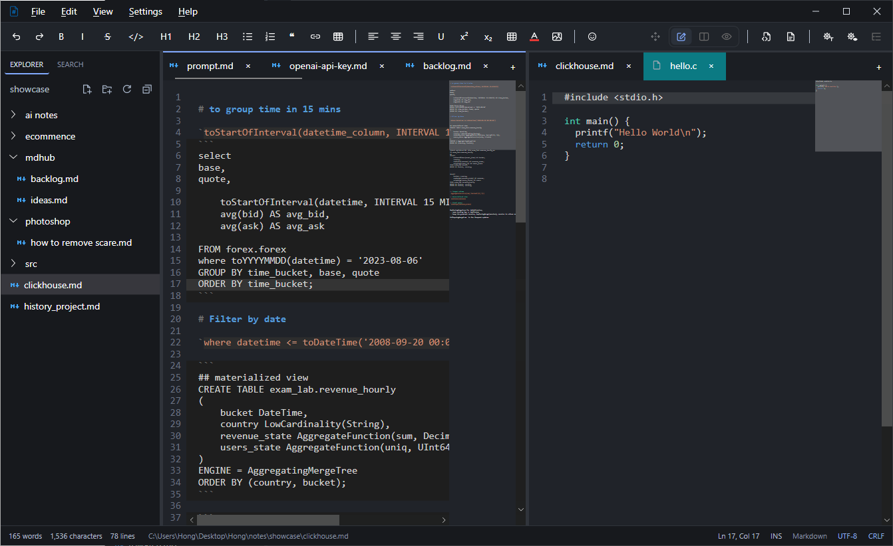
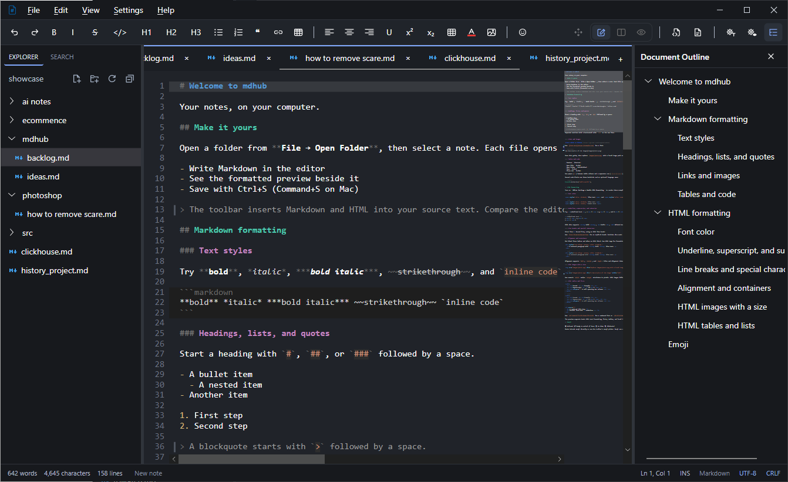

<p align="center">
  
</p>

<h1 align="center">MDHub</h1>

<p align="center">
  Your notes, as plain Markdown files on your own disk: fast to search, simple to write, readable forever.
</p>

MDHub is a desktop app for keeping personal notes and journals locally. It has no proprietary format or database. Every note is an ordinary text file that any editor can open, now or decades from now. On top of that, MDHub adds fast search and just enough formatting.

<p align="center">
  
  
</p>

## Features

- **Plain `.md` files, no lock-in.** Notes and journals are saved and organized as standard Markdown files in ordinary folders. Any text editor can open them, even everyone's favorite, vim.
- **Fully offline.** Everything works locally, with no account, no cloud and no network.
- **Fast search.** Find anything across all your saved notes in moments.
- **A familiar editor.** The editor works like VS Code and uses similar keyboard shortcuts. Vertical editing, **(ctrl+p)quick open**, mini-map in editor are supported.
- **Side-by-side editors.** Press `Ctrl+\` (or `Ctrl+Shift+\`) to split the current note to the right. Compare and edit documents side-by-side.<br> 
- **Code syntax colors.** Highlight source files and Markdown code blocks, with inline code styling in `.md` files. The editor gear's **Code syntax highlighting** option is on by default and applies immediately. [Languages and settings](docs/code-syntax-highlighting.md).
- **HTML formatting.** Mix HTML with Markdown, or preview `.html` files using supported tags, alignment, colors, tables and lists. [Supported HTML and settings](docs/html-formatting.md).
- **Document outline** Show document outline. Quick overview document and fast navigate document.<br> 
- **Image attachment** Copy and paste images to `md` file. MDHub will handle the rest for you and place the images in .assets folder.
- **Easy to house-keep** by `Removed unused images` to remove images that have not been linked in any markdown files.
- **Preview image** Fast preview in app.
- **Spell checking** Basic spell checking.
- **Legacy encoding** Support legacy file encoding.
- **Windows and Linux EOL** Support and Windows, Linux and MAC end-of-line character`(\r\n,\n)`

## Download

Latest MDHub is available from [GitHub Releases](https://github.com/hong56hk/mdhub/releases).

## Build from source

Install the [.NET 10 SDK](https://dotnet.microsoft.com/download), then run:

```bash
git clone https://github.com/hong56hk/mdhub
cd mdhub
dotnet run --project Mdhub.csproj
```

## License

MDHub is released under the [MIT License](LICENSE).

MDHub includes third-party components, such as the Hunspell spell-checking engine, spelling dictionaries and file-type icons, under their own licenses. See [THIRD-PARTY-NOTICES.md](THIRD-PARTY-NOTICES.md).
